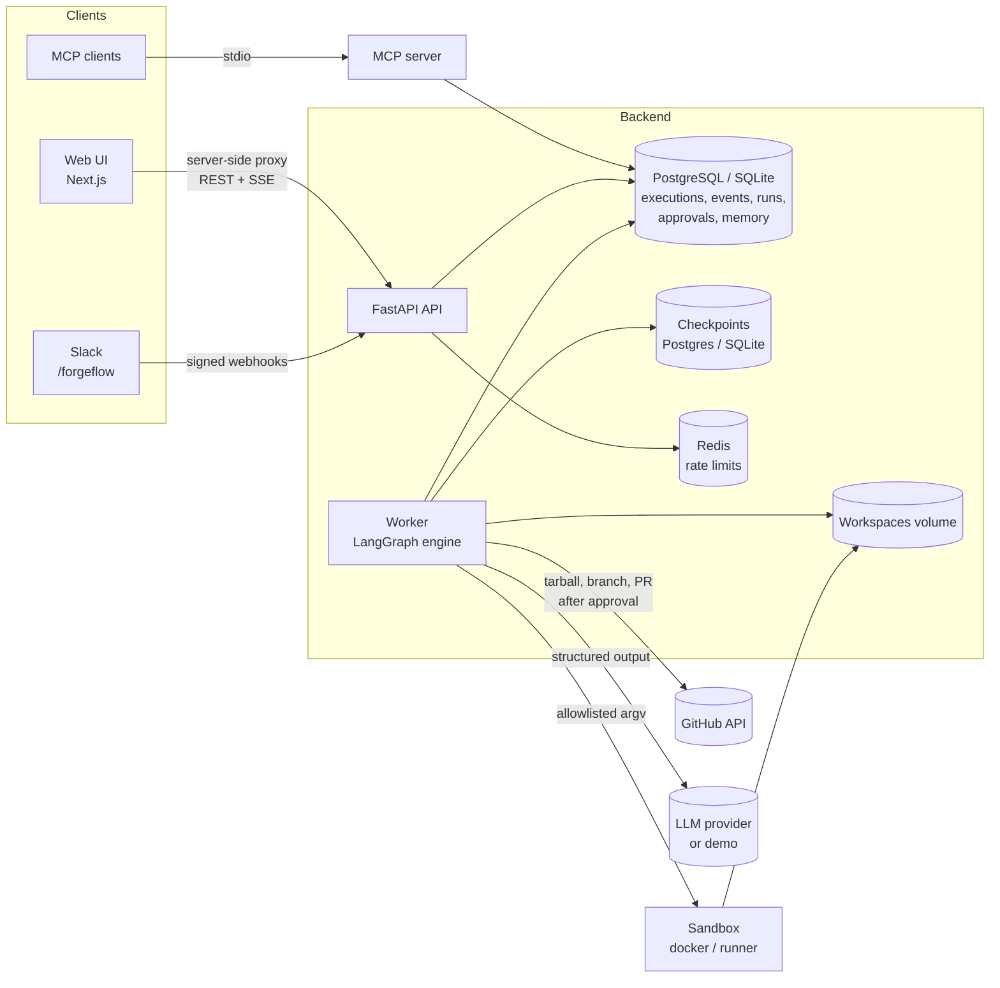
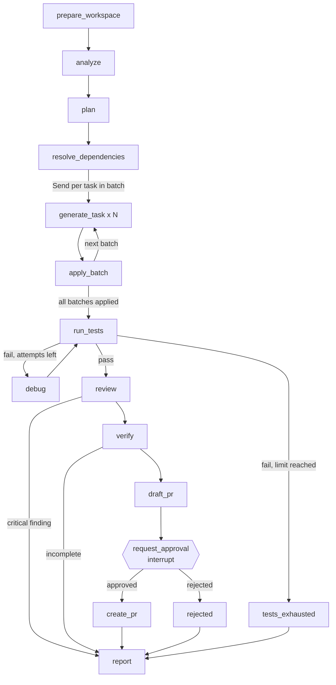
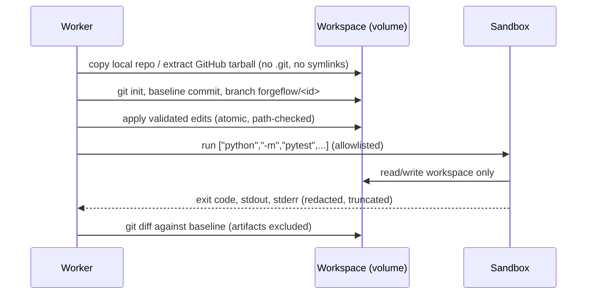

# Architecture

## Components



- **API** (`forgeflow.api`) validates requests, enforces authentication/roles/rate limits and
  writes executions as `queued`. It never runs graphs itself.
- **Worker** (`forgeflow.orchestration.engine.Worker`) claims queued or resuming executions from
  the database and drives LangGraph. It can run embedded in the API process (development) or as
  separate processes (Compose).
- **Checkpoints** make executions resumable across processes: an execution can pause for
  approval on one worker and resume on another.
- **Event log** (`execution_events`) is append-only with a per-execution sequence number. The
  SSE endpoint replays from any sequence (`Last-Event-ID`), so reconnecting clients neither miss
  nor duplicate events.

## Agents

Each agent is a module with a narrow interface; graph nodes are thin adapters that validate
state, call one agent and write validated results back.

| Agent | Module | Model use | Tools |
| --- | --- | --- | --- |
| Engineering Orchestrator | `orchestration/*` | none | workspace creation, dependency resolution, dispatch, reports |
| Repository Analyst | `agents/analyst.py` | summary only | static indexer, BM25 retrieval, repository memory |
| Task Planning Agent | `agents/planner.py` | `ImplementationPlan` | historical memory recall |
| Code Generation Agent | `agents/coder.py` | `PatchProposal` | workspace read, validated patch apply |
| Debugging Agent | `agents/debugger.py` | `Diagnosis` | failure parsing, file reads, patch apply |
| Code Review Agent | `agents/reviewer.py` | `ReviewReport` | static diff rules |
| Verification Agent | `agents/verifier.py` | `CriteriaAssessment` | sandboxed tests and linters |
| Pull Request Agent | `agents/pr_agent.py` | `PRNarrative` | GitHub branch/commit/PR (after approval) |

The PR body's verification, review and limitation sections are generated from recorded results,
not by the model, so the description cannot claim tests that did not run.

## Workflows

Five graphs are assembled from shared node groups (`orchestration/workflows.py`):



| Workflow | Shape |
| --- | --- |
| `feature` | Full graph above |
| `test_generation` | Same graph; planner in test-only mode, edits outside test files rejected |
| `bug_investigation` | prepare, analyze, reproduce (failing regression test), reproduce_tests, debug/test loop, review, verify, approval, PR |
| `code_review` | load_diff (GitHub PR or supplied diff), review, report |
| `repo_onboarding` | prepare, analyze (writes repository memory), report |

### Graph engineering details

- **Typed state**: `ExecutionState` (TypedDict) holds JSON-compatible data produced by
  validated Pydantic models; nodes re-validate on read.
- **Parallelism**: `dispatch_batch` returns `Send` objects for every task in the current
  dependency batch; results merge through an `operator.add` reducer, then `apply_batch` applies
  them in deterministic task order.
- **Determinism**: routing functions depend only on state. Dependency batches are ordered by
  priority then task id.
- **Bounded retries**: `RetryPolicy` for transient transport errors on model-backed nodes; the
  debug loop has a hard limit (`FORGEFLOW_MAX_DEBUG_ATTEMPTS`).
- **Human in the loop**: `request_approval` calls `interrupt()`. Everything before the interrupt is
  idempotent because the node re-executes on resume.
- **Cancellation and timeouts**: every node checks a cancellation flag; nodes run under
  `asyncio.timeout(node_timeout)` and the whole run under `execution_timeout`.
- **Error recovery**: an execution that fails with an exception keeps its checkpoint and can be
  resumed with `POST /api/executions/{id}/retry`.
- **Idempotent external actions**: approvals are reused on re-entry, branch pushes succeed only if
  an existing branch has the identical tree, and PR creation returns an existing PR for the branch.

## Workspaces and sandboxing



Sandbox backends are interchangeable (`workspace/sandbox.py`): `docker` (per-command container),
`runner` (Compose service on an internal network) and `local` (subprocess with rlimits, for tests
and the scripted demo only).

## Memory

| Level | Storage | Contents |
| --- | --- | --- |
| Execution | `executions`, `execution_events`, `agent_runs`, `tool_calls`, `approvals`, checkpoints | request, state, agent outputs, tool results, errors, pending approvals |
| Repository | `repository_memory` | architecture, conventions, dependencies, test structure, modules |
| Historical | `historical_memory` | investigations, approved fixes, failure patterns, decisions |

Memory is redacted before storage. Retention: events older than `FORGEFLOW_EVENT_RETENTION_DAYS`
for finished executions and history older than `FORGEFLOW_HISTORY_RETENTION_DAYS` are purged by
the worker; workspaces are removed at the end of an execution (or after
`FORGEFLOW_WORKSPACE_RETENTION_HOURS` for locally prepared PRs). `DELETE
/api/repositories/{id}/memory` erases a repository's memory.

Retrieval is lexical (BM25 over identifier-aware tokens of line windows). Embeddings and pgvector
were left out deliberately: for typical repository sizes, lexical retrieval finds the relevant
files, is deterministic and costs nothing. The indexer interface allows adding a semantic
retriever later.

## Observability

- `agent_runs`: one row per agent invocation (node, attempt, status, duration, provider, model,
  tokens, estimated cost, trace id).
- `tool_calls`: one row per tool call (redacted arguments, status, duration, result summary).
- OpenTelemetry spans for agent runs and tool calls; export with
  `FORGEFLOW_OTEL_EXPORTER_OTLP_ENDPOINT`.
- LangSmith tracing of model calls works through LangChain's standard `LANGSMITH_*` variables.
- APIs: `/api/executions/{id}/trace`, `/api/metrics`, `/api/agents`.

## Repository layout

```
apps/web/                 Next.js UI (proxy, SSE hooks, React Flow graph, diff viewer)
backend/src/forgeflow/
  agents/                 eight agents + registry
  orchestration/          state, nodes, workflows, engine/worker, dependency resolution
  workspace/              workspace manager, sandboxes
  repository/             indexer and retrieval
  integrations/           GitHub, Slack
  llm/                    provider-independent interface, LangChain adapter, demo provider
  memory/, events/        memory store, event bus
  security/               auth, command policy, redaction, untrusted-content fencing, rate limit
  api/                    FastAPI app, routes, schemas
  mcp_server.py           MCP tools
  sandbox_runner.py       sandbox runner service
backend/tests/            unit, integration, e2e
examples/sample-repos/    taskboard-api sample used by demos and tests
infrastructure/docker/    backend and sandbox images
```
